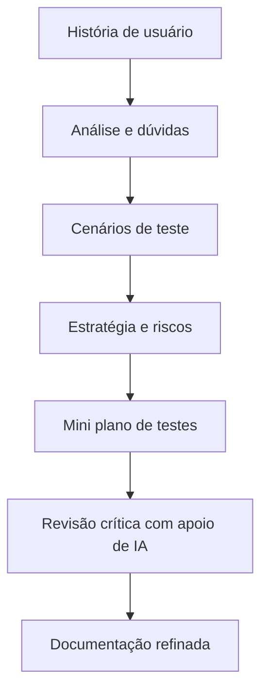

# Testes com Inteligência Artificial — Plano de Testes Hub de Leitura

[](https://github.com/priottomarcos7-coder/qa-portifolio)
[](https://github.com/priottomarcos7-coder/testes-IA)
[](https://github.com/priottomarcos7-coder/testes-IA/actions/workflows/tests.yml)

## Objetivo

Projeto de estudo desenvolvido para demonstrar como a Inteligência Artificial pode apoiar atividades de Qualidade de Software, sem substituir a análise crítica do QA.

O contexto utilizado é uma funcionalidade de biblioteca que bloqueia automaticamente usuários com livros em atraso por mais de 7 dias. O trabalho documenta análise de requisitos, cenários, estratégia, riscos e um mini plano de testes.

> **Aplicação demonstrativa:** além do planejamento, o repositório contém uma API e telas próprias para exercitar a regra de bloqueio. Trata-se de um ambiente didático, não do sistema oficial da EBAC. Os resultados só devem ser considerados aprovados após execução local ou no GitHub Actions.

## Fluxo de trabalho



## O que desenvolvi

- Análise da história de usuário e identificação de ambiguidades.
- Perguntas para esclarecer regras com o time de produto.
- Cenários positivos, negativos, de limite, erro e integração.
- Definição de prioridades, pré-condições, dados e resultados esperados.
- Estratégia de testes funcionais, API, interface, integração, exploratórios e regressão.
- Identificação de riscos e ações de mitigação.
- Matriz de rastreabilidade entre requisitos e cenários.
- Prompts para análise, geração e revisão de cenários.
- Exemplo documentado de refinamento de prompt e revisão humana.
- API REST demonstrativa com persistência local, perfil e painel administrativo.
- 20 testes de API e 4 testes de interface automatizados com Cypress (24 execuções para 20 cenários funcionais rastreados).

## Como a IA foi utilizada

A IA foi usada para ampliar possibilidades de análise e organizar ideias de teste. As respostas foram tratadas como sugestões: regras não descritas foram marcadas como pendentes de confirmação, e os cenários foram revisados para evitar assumir comportamentos que a história não define.

Um exemplo importante é o limite de 7 dias: a história diz “mais de 7 dias”, então 8 dias é um exemplo claro de bloqueio, enquanto o comportamento exatamente no 7º dia precisa ser confirmado com produto.

## Estrutura do projeto

```text
docs/
├── 01-analise-historia.md
├── 02-cenarios-de-teste.md
├── 03-estrategia-de-testes.md
├── 04-riscos.md
├── 05-mini-plano-de-testes.md
├── 06-prompts-ia.md
├── 07-conclusao.md
└── 08-matriz-rastreabilidade.md

README.md
```

## Documentação

| Documento | Conteúdo |
|---|---|
| [Análise da história](docs/01-analise-historia.md) | Ambiguidades, perguntas e regras a esclarecer |
| [Cenários de teste](docs/02-cenarios-de-teste.md) | 20 cenários com prioridade, pré-condições e resultados |
| [Estratégia de testes](docs/03-estrategia-de-testes.md) | Abordagens de validação e ordem sugerida |
| [Análise de riscos](docs/04-riscos.md) | Riscos, impactos e mitigações |
| [Mini plano de testes](docs/05-mini-plano-de-testes.md) | Objetivo, escopo e critérios de entrada/saída |
| [Prompts e revisão com IA](docs/06-prompts-ia.md) | Prompts, refinamento e revisão humana |
| [Conclusão](docs/07-conclusao.md) | Principais aprendizados e pontos críticos |
| [Matriz de rastreabilidade](docs/08-matriz-rastreabilidade.md) | Relação entre requisitos e cenários |
| [Aplicação e testes executáveis](docs/09-aplicacao-e-testes.md) | Instalação, execução e limitações |
| [Aplicação e testes executáveis](docs/09-aplicacao-e-testes.md) | Como iniciar a aplicação e executar os cenários |

## Como executar

Pré-requisitos: Node.js 20+ e npm.

```bash
npm install
npm start
```

Em outro terminal:

```bash
npm test
```

Para executar separadamente, use `npm run test:api` ou `npm run test:ui`. A aplicação fica em `http://localhost:3000`, o painel em `/admin.html` e o perfil em `/profile.html?id=2`. O GitHub Actions executa a suíte em push e pull request direcionados à branch `main`.

## Resultado e aprendizado

O projeto demonstra que o uso de IA em QA exige direcionamento, validação e senso crítico. Um prompt mais específico pode ampliar a cobertura, mas cabe ao profissional verificar se as sugestões fazem sentido para os requisitos e para o produto.

## Repositório de referência

[Hub de Leitura Integrado — EBAC-QE](https://github.com/EBAC-QE/hub-de-leitura-integrado)

## Autor

**Marcos Priotto**

Projeto desenvolvido como parte da formação em Engenharia de Qualidade de Software na EBAC.

---

# English Version

# AI-Assisted Testing — Reading Hub Test Plan

## Goal

This study project demonstrates how Artificial Intelligence can support Software Quality Assurance without replacing the QA professional's critical thinking. The example is a library feature that blocks users with loans overdue by more than 7 days.

The repository includes requirements analysis, test planning, a traceability matrix, and a self-contained demo application with a REST API, web screens, and Cypress automation.

> **Note:** the application is an educational prototype, independent from EBAC's official system. The automated tests validate this prototype, not the official reference system.

## What I developed

- User story analysis, ambiguities, and questions for the product team.
- 20 test scenarios (CT01–CT20), with priorities, test data, and expected results.
- Functional, API, UI, integration, exploratory, and regression test strategy.
- Risk analysis and requirements-to-tests traceability matrix.
- AI prompts, refinement example, and human review.
- Demo REST API built with Node.js and Express, using local JSON persistence.
- Demo user profile and admin dashboard.
- Cypress automation: 20 API tests and 4 UI tests.
- GitHub Actions pipeline.

## Run locally

Requirements: Node.js 20+ and npm.

```bash
npm install
npm start
```

In another terminal:

```bash
npm test
```

You can also run the API and UI suites separately with `npm run test:api` and `npm run test:ui`. The application runs at `http://localhost:3000`; the admin dashboard is at `/admin.html` and the user profile at `/profile.html?id=2`.

## Project documentation

| Document | Content |
|---|---|
| [User story analysis](docs/01-analise-historia.md) | Ambiguities and questions |
| [Test scenarios](docs/02-cenarios-de-teste.md) | 20 functional scenarios |
| [Test strategy](docs/03-estrategia-de-testes.md) | Validation approaches |
| [Risk analysis](docs/04-riscos.md) | Risks and mitigations |
| [Mini test plan](docs/05-mini-plano-de-testes.md) | Scope and criteria |
| [AI prompts and review](docs/06-prompts-ia.md) | Prompt refinement and human review |
| [Conclusion](docs/07-conclusao.md) | Main learnings |
| [Traceability matrix](docs/08-matriz-rastreabilidade.md) | Requirements mapped to scenarios |
| [Application and executable tests](docs/09-aplicacao-e-testes.md) | Setup, execution, and limitations |

## Test results and limitations

The suite contains 24 automated executions: 20 API checks and 4 UI checks. CT07, CT08, CT09, and CT18 are exercised at more than one layer. Therefore, the project tracks 20 functional scenarios and has 24 automated test cases. Check the repository's Actions tab for the latest workflow result.

The prototype uses simulated admin authorization, a local JSON file, and test setup endpoints. It is not production-ready. Its tests do not prove the behavior of EBAC's official system.

## Use of AI

AI supported test idea generation and documentation. Suggestions were critically reviewed against the user story. For example, “more than 7 days” makes 8 days the first clearly eligible value, while the exact business rule should be confirmed with the product team.

## Reference repository

[Reading Hub Integrated — EBAC-QE](https://github.com/EBAC-QE/hub-de-leitura-integrado)

## Author

**Marcos Priotto**

Study project developed as part of Software Quality Engineering training.
