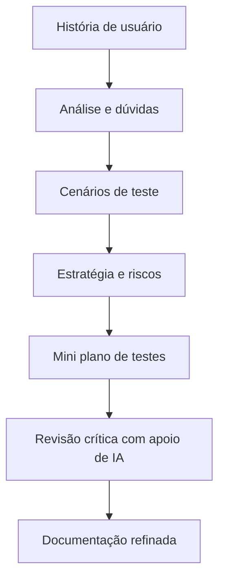
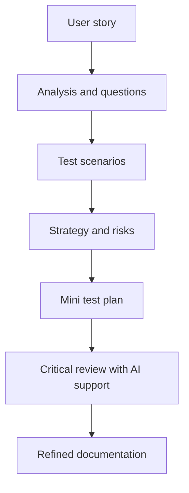

# Testes com Inteligência Artificial — Plano de Testes Hub de Leitura

[](https://github.com/priottomarcos7-coder/qa-portifolio)
[](https://github.com/priottomarcos7-coder/testes-IA)
[](https://github.com/priottomarcos7-coder/testes-IA)

## Objetivo

Projeto de estudo desenvolvido para demonstrar como a Inteligência Artificial pode apoiar atividades de Qualidade de Software, sem substituir a análise crítica do QA.

O contexto utilizado é uma funcionalidade de biblioteca que bloqueia automaticamente usuários com livros em atraso por mais de 7 dias. O trabalho documenta análise de requisitos, cenários, estratégia, riscos e um mini plano de testes.

> **Aplicação demonstrativa:** além do planejamento, o repositório contém uma API e telas próprias para exercitar a regra de bloqueio. Trata-se de um ambiente didático, não do sistema oficial da EBAC. Os resultados só devem ser considerados aprovados após execução local ou no GitHub Actions.

## Fluxo de trabalho



## O que desenvolvi

- Análise da história de usuário e identificação de ambiguidades.
- Perguntas para esclarecer regras com o time de produto.
- Cenários positivos, negativos, de limite, erro e integração.
- Definição de prioridades, pré-condições, dados e resultados esperados.
- Estratégia de testes funcionais, API, interface, integração, exploratórios e regressão.
- Identificação de riscos e ações de mitigação.
- Matriz de rastreabilidade entre requisitos e cenários.
- Prompts para análise, geração e revisão de cenários.
- Exemplo documentado de refinamento de prompt e revisão humana.\n- API REST demonstrativa com persistência local, perfil e painel administrativo.\n- 20 cenários automatizados com Cypress e verificações de interface.

## Como a IA foi utilizada

A IA foi usada para ampliar possibilidades de análise e organizar ideias de teste. As respostas foram tratadas como sugestões: regras não descritas foram marcadas como pendentes de confirmação, e os cenários foram revisados para evitar assumir comportamentos que a história não define.

Um exemplo importante é o limite de 7 dias: a história diz “mais de 7 dias”, então 8 dias é um exemplo claro de bloqueio, enquanto o comportamento exatamente no 7º dia precisa ser confirmado com produto.

## Estrutura do projeto

```text
docs/
├── 01-analise-historia.md
├── 02-cenarios-de-teste.md
├── 03-estrategia-de-testes.md
├── 04-riscos.md
├── 05-mini-plano-de-testes.md
├── 06-prompts-ia.md
├── 07-conclusao.md
└── 08-matriz-rastreabilidade.md

README.md
```

## Documentação

| Documento | Conteúdo |
|---|---|
| [Análise da história](docs/01-analise-historia.md) | Ambiguidades, perguntas e regras a esclarecer |
| [Cenários de teste](docs/02-cenarios-de-teste.md) | 20 cenários com prioridade, pré-condições e resultados |
| [Estratégia de testes](docs/03-estrategia-de-testes.md) | Abordagens de validação e ordem sugerida |
| [Análise de riscos](docs/04-riscos.md) | Riscos, impactos e mitigações |
| [Mini plano de testes](docs/05-mini-plano-de-testes.md) | Objetivo, escopo e critérios de entrada/saída |
| [Prompts e revisão com IA](docs/06-prompts-ia.md) | Prompts, refinamento e revisão humana |
| [Conclusão](docs/07-conclusao.md) | Principais aprendizados e pontos críticos |
| [Matriz de rastreabilidade](docs/08-matriz-rastreabilidade.md) | Relação entre requisitos e cenários |\n| [Aplicação e testes executáveis](docs/09-aplicacao-e-testes.md) | Como iniciar a aplicação e executar os cenários |

## Como executar\n\nPré-requisitos: Node.js 20+ e npm.\n\n```bash\nnpm install\nnpm start\n```\n\nEm outro terminal, execute a suíte completa:\n\n```bash\nnpm test\n```\n\nA aplicação fica em `http://localhost:3000`. O painel demonstrativo está em `/admin.html` e o perfil em `/profile.html?id=2`. O GitHub Actions executa os testes a cada push e pull request.\n\n## Resultado e aprendizado

O projeto demonstra que o uso de IA em QA exige direcionamento, validação e senso crítico. Um prompt mais específico pode ampliar a cobertura, mas cabe ao profissional verificar se as sugestões fazem sentido para os requisitos e para o produto.

## Repositório de referência

[Hub de Leitura Integrado — EBAC-QE](https://github.com/EBAC-QE/hub-de-leitura-integrado)

## Autor

**Marcos Priotto**

Projeto desenvolvido como parte da formação em Engenharia de Qualidade de Software na EBAC.

---

# English Version

# Artificial Intelligence Testing — Reading Hub Test Plan

## Goal

This study project demonstrates how Artificial Intelligence can support Software Quality activities without replacing the QA professional's critical judgment.

The context is a library feature that automatically blocks users with books overdue by more than 7 days. The work documents requirements analysis, test scenarios, strategy, risks, and a mini test plan.

> **Important:** this repository documents test planning and analysis. It is not an executed test suite and does not prove that the feature has been implemented in the reference system.

## Workflow



## What I Developed

- User story analysis and ambiguity identification.
- Questions to clarify business rules with the product team.
- Positive, negative, boundary, error, and integration scenarios.
- Priorities, preconditions, test data, and expected results.
- Functional, API, UI, integration, exploratory, and regression test strategy.
- Risk identification and mitigation actions.
- Requirements-to-test traceability matrix.
- Prompts for analysis, scenario generation, and review.
- A documented example of prompt refinement and human review.

## Use of Artificial Intelligence

AI was used to expand analysis possibilities and organize test ideas. Its output was treated as suggestions: undefined rules were marked for product clarification, and scenarios were reviewed to avoid assuming behavior not specified in the story.

For example, the story says “more than 7 days.” Therefore, 8 days is a clear blocking example, while behavior on exactly day 7 must be confirmed with the product team.

## Project Documentation

| Document | Content |
|---|---|
| [User story analysis](docs/01-analise-historia.md) | Ambiguities, questions, and rules to clarify |
| [Test scenarios](docs/02-cenarios-de-teste.md) | 20 scenarios with priorities, preconditions, and expected results |
| [Test strategy](docs/03-estrategia-de-testes.md) | Validation approaches and suggested order |
| [Risk analysis](docs/04-riscos.md) | Risks, impact, and mitigation |
| [Mini test plan](docs/05-mini-plano-de-testes.md) | Objective, scope, and entry/exit criteria |
| [AI prompts and review](docs/06-prompts-ia.md) | Prompts, refinement, and human review |
| [Conclusion](docs/07-conclusao.md) | Main learnings and critical points |
| [Traceability matrix](docs/08-matriz-rastreabilidade.md) | Relationship between requirements and scenarios |

## Learning Outcome

The project shows that using AI in QA requires direction, validation, and critical thinking. A more specific prompt can improve test coverage, but the professional must verify whether the suggestions match the requirements and product behavior.

## Reference Repository

[Reading Hub Integrated — EBAC-QE](https://github.com/EBAC-QE/hub-de-leitura-integrado)

## Author

**Marcos Priotto**

Project developed as part of the Software Quality Engineering training program at EBAC.
